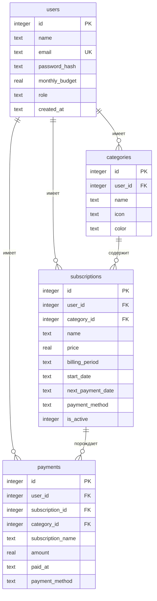

# Subly — сервис для отслеживания подписок

Веб-приложение, в котором пользователь ведёт свои подписки (музыка, фильмы, VPN, облако и т.д.),
видит ближайшие списания, расходы за месяц и аналитику платежей.

**Стек:** ASP.NET Core 8 (C#) · SQLite · Dapper · JWT · HTML/CSS/JavaScript без фреймворков · Swagger · Docker

---

## Что умеет

| Раздел | Возможности |
|---|---|
| Регистрация и вход | Проверка почты и пароля, пароль хранится как хеш BCrypt, вход по JWT-токену |
| Главная | Расходы за месяц и сравнение с прошлым, ближайшее списание, список подписок с фильтрами и поиском, расходы по категориям, совет по экономии |
| Подписки | Добавление, изменение, пауза, удаление. Ежемесячные и ежегодные. Прошедшие списания автоматически попадают в историю |
| Категории | Музыка, Фильмы и сериалы, VPN, Облако, Игры, Образование, Софт (создаются при регистрации) + свои категории с цветом и иконкой |
| Аналитика | Расходы по месяцам с прогнозом, структура по категориям, история платежей, выгрузка в CSV, переключение года |
| Профиль | Имя, почта, траты за текущий месяц, бюджет, смена пароля, удаление аккаунта с подтверждением (пароль + слово «УДАЛИТЬ» + галочка) |

**Аккаунт администратора** создаётся автоматически при первом запуске:
`admin@subly.ru` / `Admin2026`, имя — Александр Круглов (с примерами подписок и историей платежей за 9 месяцев).
Почту, пароль и имя можно поменять в `appsettings.json`, раздел `Admin`, **до первого запуска**
(потом пароль меняется в профиле). Если в базе остался старый `demo@subly.ru`, он сам станет администратором.
Роль хранится в колонке `users.role` (`user` или `admin`) и передаётся в JWT-токене — пригодится для меню администратора.

---

## Запуск на своём компьютере

### Visual Studio — запуск по F5

Ничего, кроме Visual Studio (с рабочей нагрузкой «ASP.NET и разработка веб-приложений»), ставить не нужно.

1. Дважды щёлкните по файлу **`Subly.sln`** — откроется Visual Studio.
2. Нажмите **F5** (или зелёную кнопку ▶ **Subly**).
3. Откроется браузер с сайтом http://localhost:5080. Документация API — http://localhost:5080/swagger.

При первом запуске Visual Studio скачает пакеты NuGet, а приложение само создаст файл базы данных
**`subly.db`** в папке проекта с таблицами и аккаунтом администратора `admin@subly.ru` / `Admin2026`.

> Открывайте именно `Subly.sln`, а не папку (`Файл → Открыть → Папка`): в режиме папки F5 не работает.

**Посмотреть таблицы:** откройте `subly.db` в бесплатной программе
[DB Browser for SQLite](https://sqlitebrowser.org/) → вкладка «Данные». Чтобы начать с чистой базы, остановите сайт
и удалите файлы `subly.db*` — при следующем запуске они создадутся заново.

Без Visual Studio: в папке проекта выполните `dotnet run`.

### Docker

```bash
docker compose up --build
```
Сайт — http://localhost:8080, Swagger — http://localhost:8080/swagger. База хранится в томе `subly-data`.

---

## Как устроен проект

```
Subly/
├── Program.cs                 — настройка приложения: JWT, Swagger, статические файлы
├── Subly.sln                  — файл решения: откройте его и нажмите F5
├── appsettings.json           — путь к файлу базы SQLite, ключ JWT
├── Database/schema.sql        — схема базы данных (выполняется при запуске)
├── Data/
│   ├── Db.cs                  — подключение к SQLite
│   └── DbInitializer.cs       — создание таблиц и демо-данных
├── Models/Entities.cs         — классы User, Category, Subscription, Payment
├── Dtos/Dtos.cs               — объекты запросов и ответов API
├── Services/
│   ├── PaymentSync.cs         — автоматический учёт списаний
│   ├── StatsService.cs        — подсчёт статистики (месяц, категории, совет)
│   ├── TokenService.cs        — выпуск JWT-токенов
│   ├── Rules.cs               — правила валидации, стандартные категории
│   └── Clock.cs               — «сегодня» по московскому времени
├── Controllers/               — REST API
└── wwwroot/                   — сайт (фронтенд)
    ├── login.html, register.html          — вход и регистрация
    ├── dashboard.html, analytics.html,
    │   categories.html, profile.html      — страницы приложения (разметка + шаблоны <template>)
    ├── css/
    │   ├── base.css         — цвета (светлая и тёмная тема), шрифты, общие правила
    │   ├── components.css   — кнопки, поля, карточки, окна, переключатель темы
    │   ├── layout.css       — расположение блоков, адаптация под телефон
    │   ├── pages.css        — стили отдельных страниц
    │   └── animations.css   — анимации
    └── js/                  — загрузка данных из API и заполнение страниц
        ├── theme.js         — светлая / тёмная тема
        ├── palette.js       — быстрый поиск по Ctrl+K
        └── …
```

### Оформление

- Дизайн — светлый, в духе популярных сервисов (Linear, Stripe, Revolut, Rocket Money): главная цифра
  месяца с полосой категорий, лента списаний на 14 дней, быстрый поиск по **Ctrl+K** (`js/palette.js`).
- Вся разметка лежит в HTML-файлах. Повторяющиеся элементы (строка подписки, карточка
  категории, окна) описаны тегом `<template>`, JavaScript только копирует их и подставляет данные.
- **Анимации** (`animations.css`): блоки плавно появляются по очереди, числа «досчитываются»,
  столбики графика растут снизу, полосы категорий заполняются, окна и меню мягко
  всплывают. Если в системе отключены анимации, сайт их тоже отключает.
- **Тёмная тема**: на компьютере — переключатель в меню слева, на телефоне — тумблер в профиле,
  на страницах входа — кнопка в углу. Новая тема
  расходится кругом от кнопки, выбор запоминается в браузере. При первом входе берётся
  тема из настроек системы.

### База данных



**Как считаются списания.** У подписки хранится дата следующего списания. При каждом запросе
`PaymentSync` проверяет: если дата уже наступила, в таблицу `payments` записывается платёж,
а дата переносится на месяц (или год) вперёд. Поэтому история платежей и аналитика всегда актуальны,
без фоновых задач. Повторная запись одного платежа невозможна — на `(subscription_id, paid_at)` стоит уникальный индекс.

Удаление выполняется явно в транзакции: при удалении подписки её платежи остаются в истории
(ссылка `subscription_id` обнуляется), при удалении аккаунта по очереди удаляются платежи, подписки,
категории и сам пользователь.

### API

Все методы, кроме регистрации и входа, требуют заголовок `Authorization: Bearer <токен>`.
Ошибки возвращаются в виде `{ "message": "текст ошибки" }`. Полная интерактивная документация — на `/swagger`.

| Метод | Адрес | Что делает |
|---|---|---|
| POST | `/api/auth/register` | Регистрация `{name, email, password}` → `{token, user}` |
| POST | `/api/auth/login` | Вход `{email, password}` → `{token, user}` |
| GET | `/api/profile` | Профиль и статистика месяца |
| PUT | `/api/profile` | Изменить имя, почту, бюджет |
| PUT | `/api/profile/password` | Сменить пароль `{currentPassword, newPassword}` |
| DELETE | `/api/profile` | Удалить аккаунт `{password, confirmation: "УДАЛИТЬ"}` |
| GET | `/api/dashboard` | Данные для главной страницы |
| GET | `/api/analytics?year=2026` | Аналитика за год |
| GET | `/api/categories` | Категории с количеством подписок и суммой в месяц |
| POST / PUT / DELETE | `/api/categories/{id}` | Создать / изменить / удалить категорию |
| GET | `/api/subscriptions?categoryId=` | Список подписок |
| GET | `/api/subscriptions/{id}` | Одна подписка |
| POST / PUT / DELETE | `/api/subscriptions/{id}` | Создать / изменить / удалить подписку |
| GET | `/api/payments?year=2026` | История платежей |

---

## Публикация в интернете (бесплатно)

С SQLite отдельный сервер базы данных не нужен — база лежит в файле рядом с сайтом. Подойдёт любой хостинг
для ASP.NET Core, например бесплатный **MonsterASP.NET** (https://www.monsterasp.net, без банковской карты):

1. Зарегистрируйтесь и создайте **Website** — получите адрес вида `subly.runasp.net`.
2. В панели у сайта найдите **Deploy → WebDeploy** и скачайте профиль публикации (`.publishsettings`).
3. В Visual Studio: правой кнопкой по проекту → **Опубликовать** → **Импорт профиля** → выберите файл → **Опубликовать**.
4. Файл `subly.db` с таблицами и демо-аккаунтом создастся на сервере при первом открытии сайта.

Перед публикацией замените в `appsettings.json` значение `Jwt:Key` на свою длинную случайную строку.

---

## Что показать преподавателю

1. **Регистрация** нового пользователя → сразу создаются 7 категорий.
2. **Добавление подписки** с прошедшей датой → платежи появляются в истории и на графике.
3. **Swagger** (`/swagger`): вызвать `/api/auth/login`, нажать **Authorize**, вставить токен и вызвать `/api/dashboard`.
4. **База данных в DB Browser for SQLite** (файл `subly.db`): таблицы `users`, `categories`, `subscriptions`, `payments`, внешние ключи, пароль в виде хеша BCrypt.
5. **Профиль**: смена пароля (проверка текущего пароля, требования к новому) и удаление аккаунта с тройным подтверждением.
